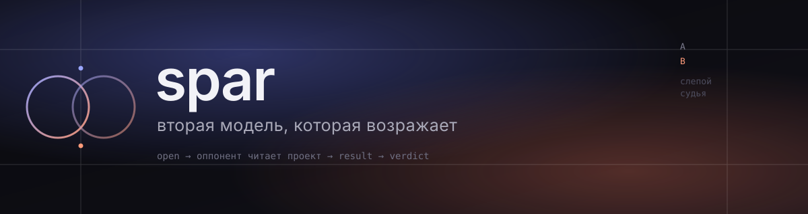

<p align="center">
  
</p>

<p align="center">
  <a href="LICENSE"></a>
  
  
  
</p>

<p align="center">
  <a href="README.md">русский</a> · <b>english</b>
</p>

---

**spar** is a DeepSeek Harness plugin that gives the agent a second opinion it
actually has to argue with. The agent states a case, a model from another provider
route answers by reading the same project with its own tools, and the exchange
lives in the chat as its own card instead of a wall of text in the agent's reply.

> Why: a model arguing with itself agrees with itself. A second route — different
> family, different weights, different blind spot — breaks that loop.

## What you actually get

**The opponent reads code, not a summary.** It gets `read`, `grep`, `glob` and
`git` inside the debate's directory, decides what to open, and the card lists what
it read. "There is nothing in `src`" is settled in one turn instead of believed.

**A turn never blocks the agent.** `open` and `say` return immediately: the debate
runs in the background, the card fills as text arrives, and the agent keeps
working. When the reply is needed, `result` waits for it — and never hands back an
older turn.

**A ruling with checks, not rhetoric.** The judge gets a clean context, sides are
labelled `A`/`B`, their order is swapped deterministically by a hash, both must be
steelmanned. The judge has to open at least one artefact per side, and a citation
missing from that side's `read:` trail is named a fabricated source.

**Configured from the UI, no restart.** The `◈` pill in the bottom-right corner
picks the opponent, the judge and the third model from the harness catalog, plus
language, project access, readings per turn, budgets and per-role temperature.

## How it looks

```text
agent ──── open "<topic>" ────►  opponent reads the project (read · grep · glob · git)
  │                                        │
  │  keeps working                         │  text, reasoning, tool steps → card
  │                                        ▼
  └──── result dN ◄──────────────  /spar-live (turn state)
                │
                ▼
         verdict dN  ──►  blind A/B, steelman, artefact checks
```

## Quick start

```bash
git clone https://github.com/ext3ndedsoft/spar-to-dsh.git
cd spar-to-dsh
node install.mjs
```

The script copies the plugin into `~/.dsh/profiles/web/plugins/spar`, appends one
entry to `cordis.patch.yml` and creates `~/.dsh/spar` for transcripts. Restart the
shell and the `◈` pill appears.

Step-by-step, with the manual path: [docs/install.md](docs/install.md).

## Configuration

```yaml
- insert:
    - id: spar
      name: "./plugins/spar/index.js"
      config:
        defaultOpponent: "<provider>/<model>"   # from your harness catalog
        judge: "<provider>/<model>"
        challenger: "<provider>/<model>"
        language: ru
        tools: true
        maxToolRounds: 3
        maxReplyTokens: 8192
        judgeTokens: 16384
        temperature: 0.8
        judgeTemperature: 0.25
```

Everything here is a default the panel can override without a restart. No model
name ships with the plugin: the catalog belongs to the installation, and until
one is picked `open` and `verdict` say so instead of guessing.

## What it is not

- **Not a service.** No telemetry, no outbound requests beyond what DSH itself
  makes to providers.
- **Not a secret store.** Transcripts hold prompts and file paths.
- **Not the truth.** A verdict is a judgement with a stated scope of checks.
- **Not a content sandbox.** The jail limits where reading happens, not what is in
  that directory.

## Docs

- [Install and uninstall](docs/install.md)
- [Changelog](CHANGELOG.md)
- [Security](SECURITY.md)

## License

MIT — see [LICENSE](LICENSE).