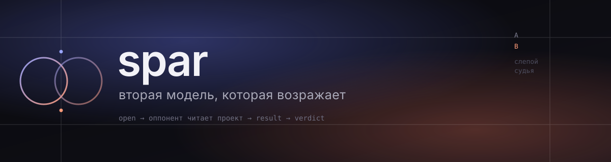

<p align="center">
  
</p>

<p align="center">
  <a href="LICENSE"></a>
  
  
  
</p>

<p align="center">
  <b>русский</b> · <a href="README.en.md">english</a>
</p>

---

**spar** — плагин для DeepSeek Harness, который даёт агенту второго собеседника.
Не «ещё один чат», а настоящий спор: ваш агент выдвигает тезис, модель из
другого маршрута возражает, читая тот же проект своими инструментами, и всё это
живёт в чате отдельной карточкой, а не простынёй в ответе агента.

> Зачем. Модель, спорящая сама с собой, соглашается с собой. Второй маршрут —
> другая семья, другие веса, другое слепое пятно — ломает этот контур.

## Что реально даёт

**Оппонент читает код, а не пересказ.** Ему даются `read`, `grep`, `glob` и
`git` внутри каталога спора. Он сам решает, что открыть, и в карточке видно
список прочитанного. Утверждение «в `src` ничего нет» проверяется за один ход,
а не принимается на веру.

**Ход не блокирует агента.** `open` и `say` возвращаются сразу: спор считается
в фоне, карточка наполняется по мере генерации, а агент продолжает работу. Когда
ответ нужен, `result` его дождётся — и не подсунет прошлый ход вместо нового.

**Приговор с проверкой, а не с риторикой.** Судья получает чистый контекст,
стороны помечены `A` и `B`, порядок переставляется детерминированно по хэшу, обе
стороны обязаны пройти стальман. Судья обязан открыть минимум один артефакт с
каждой стороны, а цитата, которой нет в следе `читал:`, помечается как
выдуманный источник. Непроверенное называется непроверенным.

**Правится из интерфейса, без рестарта.** Пилюля `◈` в правом нижнем углу:
оппонент, судья и третья модель из каталога харнесса, язык, доступ к проекту,
число чтений на ход, бюджеты, температура каждой роли. Сохранение применяется со
следующего хода.

**Спор живёт как спор.** Транскрипт хранится, к нему можно вернуться
(`show`), его можно закрыть (`close`), а прошлые приговоры попадают в
следующий спор коротким дайджестом, чтобы не переигрывать решённое.

## Как это выглядит

```text
агент ──── open "<тема>" ────►  оппонент читает проект (read · grep · glob · git)
  │                                        │
  │  продолжает работу                     │  текст, размышления, шаги — в карточку
  │                                        ▼
  └──── result dN ◄──────────────  /spar-live (состояние хода)
                │
                ▼
         verdict dN  ──►  приговор: слепые A/B, стальман, проверка артефактов
```

В чате это одна карточка на ход: модель, тег (`раунд 3`, `приговор`, `дуэль`),
время, свёрнутый блок размышлений, шаги инструментов и текст, который набирается
плавно, а не прыгает абзацами.

## Быстрый старт

```bash
git clone https://github.com/ext3ndedsoft/spar-to-dsh.git
cd spar-to-dsh
node install.mjs
```

Скрипт копирует плагин в `~/.dsh/profiles/web/plugins/spar`, дописывает запись
в `cordis.patch.yml` и создаёт `~/.dsh/spar` под транскрипты. Перезапустите
оболочку — пилюля `◈` появится в правом нижнем углу.

Руками, с разбором каждого шага — [docs/install.md](docs/install.md).

## Настройка

Профиль задаёт дефолты, панель их переопределяет:

```yaml
- insert:
    - id: spar
      name: "./plugins/spar/index.js"
      config:
        judge: deepseek            # или provider/model из каталога
        defaultOpponent: gemini
        language: ru
        tools: true
        maxToolRounds: 3
        maxReplyTokens: 8192
        judgeTokens: 16384
        timeoutMs: 180000
```

| Ключ | Что делает | По умолчанию |
|---|---|---|
| `judge` | кто выносит приговор | `deepseek` |
| `defaultOpponent` | с кем спорим по умолчанию | `gemini` |
| `challenger` | третья модель для дуэли и приговора | `sonnet-ag` |
| `language` | язык спора и приговора | `ru` |
| `tools` | давать ли оппоненту доступ к проекту | `true` |
| `maxToolRounds` | чтений на ход | `3` |
| `maxReplyTokens` / `judgeTokens` | бюджеты ответа и приговора | `8192` / `16384` |
| `temperature` / `judgeTemperature` | темп оппонента и судьи | `0.8` / `0.25` |
| `cwd` | что именно читает оппонент | каталог сессии |

Выбор моделей — по каталогу харнесса, без правки YAML: алиасы удобны, но
работает и пара `provider/model`.

## Что он не делает

- **Не сетевой сервис.** Никакой телеметрии и внешних запросов, кроме тех, что
  делает сам DSH к провайдерам.
- **Не хранилище секретов.** Транскрипты содержат промпты и пути — держите
  `~/.dsh/spar` при себе.
- **Не истина в последней инстанции.** Приговор — суждение с явно указанной
  зоной проверки, а не доказательство.
- **Не песочница по содержимому.** Клетка ограничивает место чтения, но не
  запрещает `.env` внутри каталога спора.

## Документация

- [Установка и удаление](docs/install.md)
- [История изменений](CHANGELOG.md)
- [Безопасность](SECURITY.md)

## Лицензия

MIT — см. [LICENSE](LICENSE).